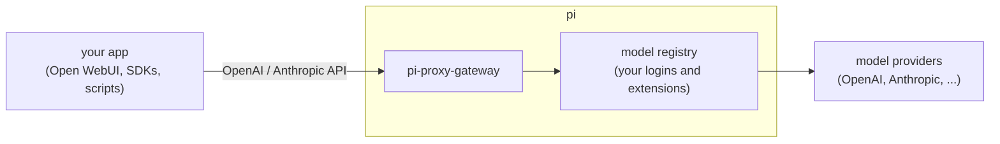

# pi-proxy-gateway

[](https://www.npmjs.com/package/pi-proxy-gateway)
[](LICENSE)

use the models [pi](https://github.com/badlogic/pi-mono) can reach from any app that speaks the OpenAI or Anthropic API.

whatever you've logged in to in pi, with an API key or OAuth, this extension serves on `localhost`. point Open WebUI, an SDK or a script at it and it talks to those models through pi.

## how it works



the gateway runs inside pi as an extension. it doesn't store keys or log in to anything itself. it asks pi to make the request, so whatever pi can use, the gateway can use, including providers added by other extensions like [pi-multi-account](https://www.npmjs.com/package/pi-multi-account).

## install

```bash
pi install npm:pi-proxy-gateway
```

start pi. you should see:

```
[proxy-gateway] API server listening on http://127.0.0.1:9876
```

check that it works:

```bash
curl http://localhost:9876/v1/models
```

## use it

models are named `provider/model`, the same way pi names them:

```bash
curl http://localhost:9876/v1/chat/completions \
  -H "Content-Type: application/json" \
  -d '{
    "model": "openai-codex/gpt-6.1-sol",
    "messages": [{ "role": "user", "content": "hi" }]
  }'
```

any OpenAI client works with `base_url = http://localhost:9876/v1`. Anthropic clients can use `http://localhost:9876` and the `/v1/messages` endpoint.

### Open WebUI

1. admin settings → connections → add an OpenAI connection.
2. URL: `http://localhost:9876/v1`. any key works unless you set one in the config.

   if Open WebUI runs in Docker, `localhost` is the container, not your machine. set `host` in the config to an address the container can reach (your machine's LAN or Tailscale IP, or `0.0.0.0`), use that address in the URL, and set an `apiKey` too.
3. optional, for better prompt caching: add this under the connection's headers.

   ```json
   { "X-OpenWebUI-Chat-Id": "{{CHAT_ID}}" }
   ```

every model pi can use shows up in the model list. the reasoning effort setting in Open WebUI is passed through.

## endpoints

| endpoint | format |
| --- | --- |
| `GET /v1/models` | OpenAI model list |
| `POST /v1/chat/completions` | OpenAI chat completions, streaming or not |
| `POST /v1/messages` | Anthropic messages, streaming or not |
| `GET /health` | health check |

there's no `/v1/responses` endpoint. use chat completions.

## what gets passed through

the gateway converts these itself:

- **messages** with text, images, tool calls and tool results, and **tools**
- **reasoning**: `reasoning_effort` (or `reasoning.effort`) from OpenAI clients, `output_config.effort` or `thinking` from Anthropic clients. pi clamps it to what each model supports. if you don't send it, pi uses the model's default.
- **max tokens**: `max_tokens` or `max_completion_tokens`. pi sends whichever field the provider wants.
- **usage**: `prompt_tokens` includes cached tokens, with `cached_tokens`, `reasoning_tokens` and pi's cost estimate in the details. set `stream_options.include_usage` to `false` to skip it.

every other field is passed on, never dropped silently:

- **same format** (an Anthropic request to an Anthropic model, an OpenAI chat request to an OpenAI-compatible model such as OpenRouter): the field is copied into the request pi sends, as is. objects are merged, so `output_config.format` sits next to pi's `effort`. a named `tool_choice` follows Claude Code's tool name casing on Anthropic logins. fields like `tool_choice`, `response_format`, `logit_bias`, `user`, `metadata`, `top_k`, `stop_sequences`, `service_tier` and per-tool `strict` all reach the provider, and so does anything new the provider adds later.
- **different format**: the gateway translates what has a clear equivalent and answers **400 naming the field** for anything else, so the client can fall back.

| client field | Anthropic model | OpenAI-compatible model | Responses / Codex model |
| --- | --- | --- | --- |
| `response_format` json_schema / `output_config.format` | `output_config.format` | `response_format` (strict) | `text.format` |
| `response_format` json_object | 400 | `response_format` | `text.format` |
| `tool_choice` required / any, named tool | `any`, `tool` | `required`, `function` | `required`, `function` |
| `parallel_tool_calls: false` / `disable_parallel_tool_use` | `disable_parallel_tool_use` | `parallel_tool_calls` | `parallel_tool_calls` |
| `stop` / `stop_sequences` | `stop_sequences` | `stop` | 400 |
| `top_p`, `temperature` | same | same | same |
| `user` / `metadata.user_id` | `metadata.user_id` | `user` | `user` |
| `seed`, penalties, `logit_bias`, `top_k` | 400 | 400 for `top_k` | 400 |
| OpenAI `metadata`, `store`, `service_tier`, `prompt_cache_key`, `verbosity` | 400 | (same format) | passed on (`verbosity` as `text.verbosity`) |

other APIs (Google, Mistral, Bedrock, Cursor…) take `temperature` and `tool_choice` `auto`/`none` through pi; any other extra field gets a 400 there. values that only ask for the default (`n: 1`, `parallel_tool_calls: true`, penalties of `0`, `response_format: text`) are fine everywhere, and so are Open WebUI's "Continue" flags (`continue_final_message`, `add_generation_prompt`).

for every model, `n` above 1, `logprobs`, `top_logprobs`, audio `modalities` and `audio` get a 400: the gateway returns one choice of text and tool calls and can't relay the rest.

`temperature` is sent even when pi would leave it out (models that reject it, or with extended thinking), so the provider's error reaches you instead of the setting vanishing. Claude Haiku 5.5, for example, rejects it.

forwarded fields are listed under `passthrough` in the request log.

when the provider rejects a request with a 4xx (a bad parameter, a rate limit), the client gets that status and the provider's message, streaming or not, so it can fall back or back off. provider auth failures (401/403, the gateway's own login) and other failures are a 502. an error after the answer has started streaming is sent as an error chunk in the stream, so a failed request doesn't look like an empty answer.

## running several pi instances

every pi you start loads the extension, but only one can use the port. the others wait in the background and check every 15 seconds. if the pi that owns the port closes, another one takes over, so the gateway stays up as long as any pi is running.

`/proxy-status` inside pi shows whether that instance is the one serving.

## config

optional. the file is `~/.pi/proxy-gateway.json` and is created on first run:

```json
{
  "port": 9876,
  "host": "127.0.0.1",
  "apiKey": "something-secret",
  "aliases": { "fast": "openai-codex/gpt-6.1-terra" },
  "defaultModel": "openai-codex/gpt-6.1-sol",
  "rateLimit": 60,
  "requestTimeoutMs": 1800000
}
```

| key | what it does |
| --- | --- |
| `port` | port to listen on, default `9876` |
| `host` | interface to bind, default `127.0.0.1`. `0.0.0.0` accepts other machines and containers |
| `apiKey` | require this key as `Authorization: Bearer` or `x-api-key` |
| `aliases` | short names for models |
| `defaultModel` | used when a request doesn't name a model |
| `rateLimit` | max requests per minute |
| `requestTimeoutMs` | how long one request can take, default 30 minutes |
| `allowedOrigins` | CORS origins, default `*` |
| `logPath` | request log, default `~/.pi/proxy-gateway-log.jsonl` |

if you used pi-model-proxy before, your `~/.pi/model-proxy.json` is copied over the first time.

## security

the gateway gives whoever can reach the port the same model access you have in pi. by default it only listens on `127.0.0.1`. if you set `host` to anything else, set an `apiKey` too.

## development

```bash
git clone https://github.com/cairodavila/pi-proxy-gateway
cd pi-proxy-gateway
npm install
npm test
npm run typecheck
pi install .   # load your local copy instead of the npm one
```

## credits

this started as a fork of [pi-model-proxy](https://github.com/BlackBeltTechnology/pi-model-proxy) by Robert Csakany / BlackBelt Technology, which is no longer maintained. the [changelog](CHANGELOG.md) lists what changed.

## license

[MIT](LICENSE)
